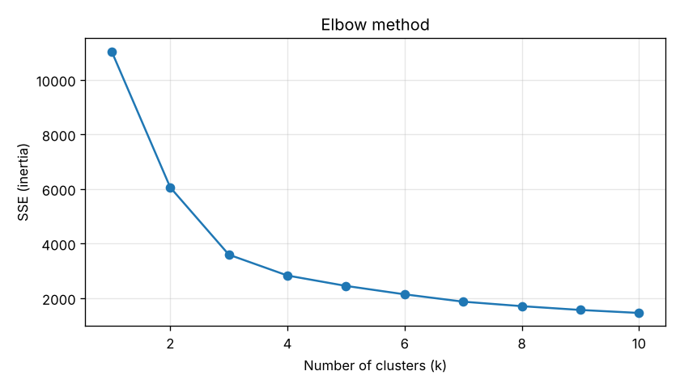
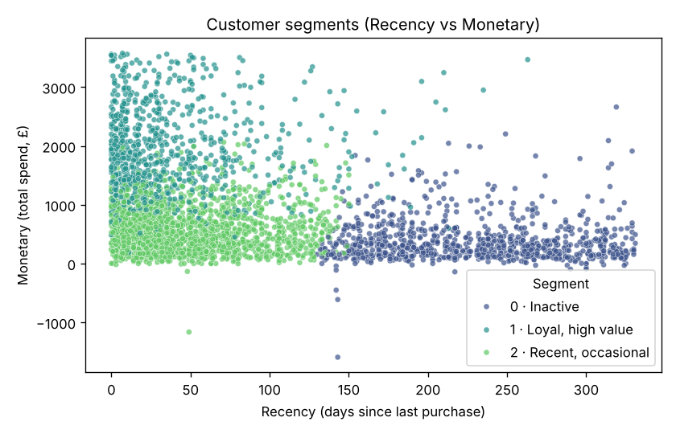
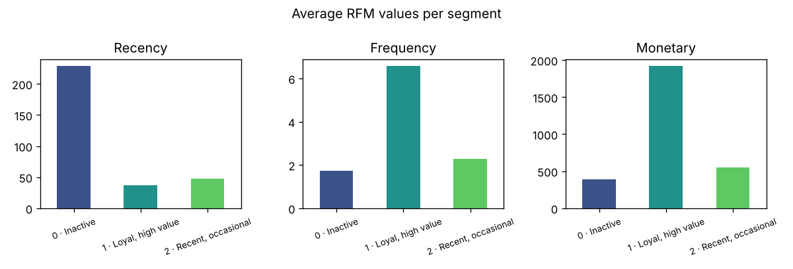

# Customer segmentation with RFM and K-means

I grouped the customers of a UK online shop by how they buy, using three numbers per customer (Recency, Frequency, Monetary) and K-means clustering.

This was my final project for the **Data Science with Python** unit (SQA, SCQF level 8) of my Diploma in Computing and IT, 2025.

## The data

The **Online Retail** dataset from the UCI Machine Learning Repository: 541,909 transaction lines from a UK-based online gift shop, December 2010 to December 2011. Each line has an invoice number, product, quantity, date, unit price, customer ID and country. The file is in this repo as `online-retails.xlsx`.

## What I did

All the work is in `online-retails.ipynb`.

1. **Cleaning.** About 25% of lines had no customer ID, so I removed them (a segment needs a customer). I also removed 5,225 duplicate lines and 40 lines with a unit price of zero. That left 401,564 lines from 4,371 customers in 37 countries.
2. **Exploring.** Price and quantity distributions, monthly sales, top countries and products by revenue, and a heatmap of sales by hour and day of the week.
3. **RFM features.** For each customer:
   - **Recency:** days since their last purchase (counted from the last date in the data)
   - **Frequency:** number of different invoices
   - **Monetary:** total spend (quantity × unit price)
4. **Outliers.** I removed customers outside 1.5 × IQR on any RFM value, which kept 3,681 of the 4,371 customers. I did this so that a few very large buyers would not dominate the clusters.
5. **Scaling and clustering.** I standardised the three values and ran K-means for k = 1 to 10. I chose k = 3 from the elbow plot, and the silhouette score agrees (0.44 for k = 2, **0.45 for k = 3**, 0.41 for k = 4).
6. **Checking the clusters.** Silhouette score, Davies-Bouldin index and Calinski-Harabasz score, plus scatter, pair, 3D and PCA plots.
7. **New customers.** A short example that scales a new customer's RFM values and predicts their segment.

## Results

| Segment | Customers | Avg. recency | Avg. orders | Avg. spend |
|---|---|---|---|---|
| **Loyal, high value** | 849 | 37 days | 7 | £1,918 |
| **Recent, occasional** | 1,910 | 48 days | 2 | £550 |
| **Inactive** | 922 | 229 days | 2 | £386 |

Cluster quality (k = 3): silhouette **0.451**, Davies-Bouldin **0.786**, Calinski-Harabasz **3,812**.

What this means for the shop, in plain terms: about a quarter of customers buy often and spend the most, so they are worth keeping happy. The largest group bought recently but only once or twice, so they are the best target for a "come back" offer. The inactive group has not bought for more than seven months.





## Limits and what I would improve

- **Returns are mixed in.** Cancelled invoices (quantities below zero) stay in the data, so Monetary is net spend and a few customers have a negative total. Next time I would handle returns separately.
- **Outlier removal drops the biggest customers.** It makes the clusters cleaner, but those customers matter most to a real shop. I would keep them and use a log scale instead, or treat them as their own group.
- **The new-customer example is not consistent.** It refits the model on all customers, including the outliers, instead of reusing the trained model. I would save the scaler and model once and reuse them.
- **K-means assumes round clusters.** Comparing it with other methods (for example a Gaussian mixture) would be a good next step.

## Run it

```bash
pip install -r requirements.txt
jupyter notebook online-retails.ipynb
```

The figures in `figures/` were generated from the same steps as the notebook.

## Tools

Python, pandas, NumPy, scikit-learn (StandardScaler, KMeans, PCA, clustering metrics), Matplotlib, seaborn.

Course practice notebooks from the same unit: [data-science-with-python](https://github.com/suwasghale/data-science-with-python)
